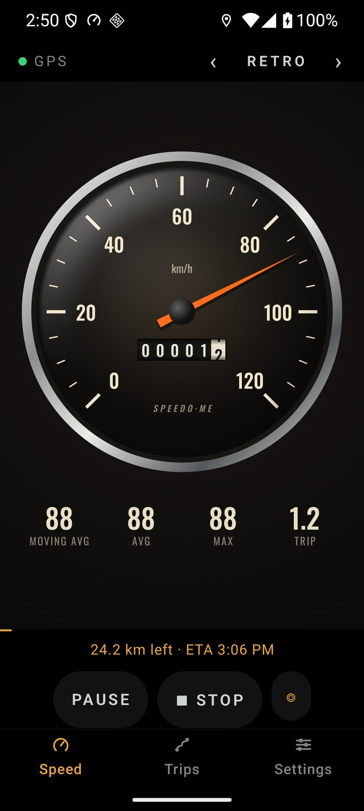
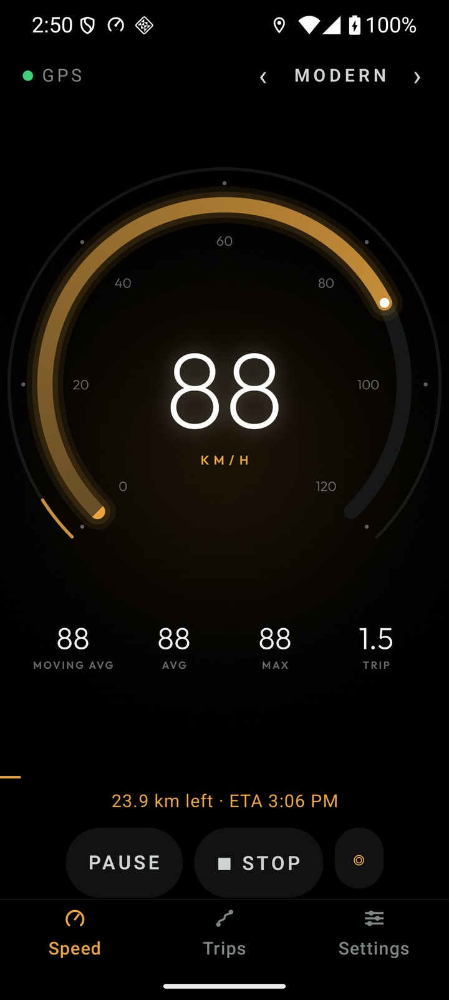
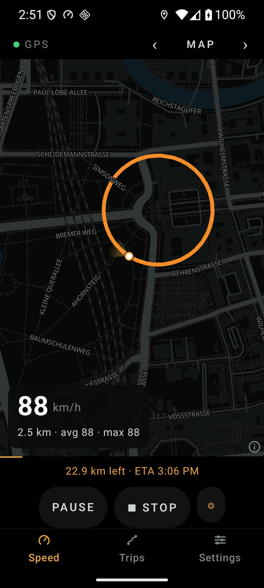
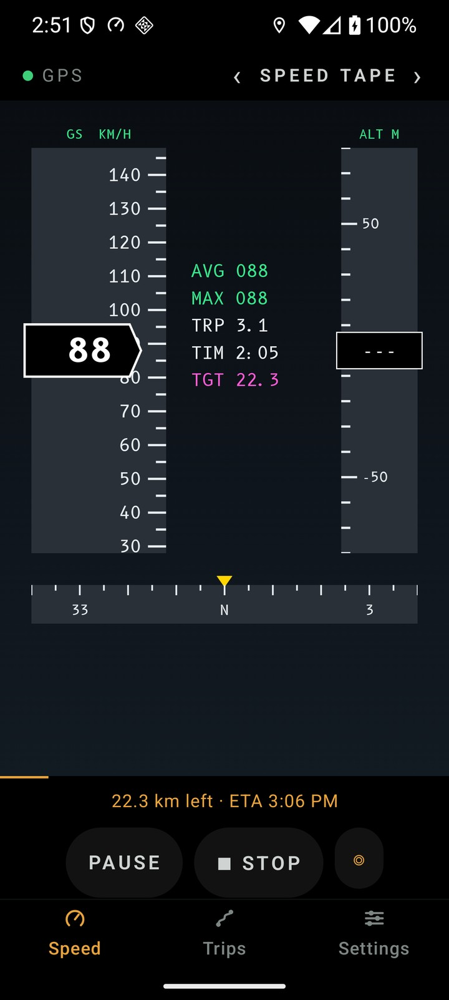
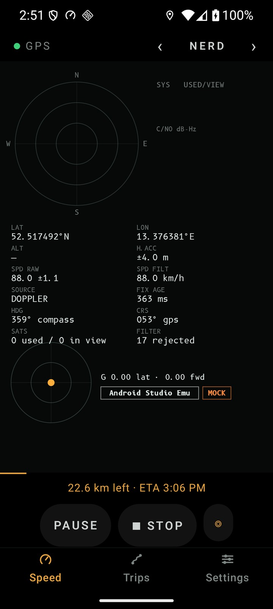

# SpeedoME

A GPS speedometer and trip computer for Android and iOS that shows the speed your GPS chip actually measures, without the 200 km/h glitches.

> **Version 1.0.1.** The iPhone Target dialog now uses the native iOS time picker, fixing the clock layout when the keyboard opens. Includes all 38 map worlds with their own hand-made speedometers and app looks. Platform details and remaining device checks are listed in [`docs/progress.md`](docs/progress.md). [Privacy policy](docs/privacy.md).

## Download 1.0.1

- **Android:** [SpeedoME-1.0.1.apk](https://github.com/ShaptakNaskar/SpeedoME/releases/download/v1.0.1/SpeedoME-1.0.1.apk) — signed universal release APK, Android 8.0+.
- **iPhone:** [SpeedoME-1.0.1-unsigned.ipa](https://github.com/ShaptakNaskar/SpeedoME/releases/download/v1.0.1/SpeedoME-1.0.1-unsigned.ipa) — iOS 16.0+; sign it with your own certificate before installing. See [iOS instructions](docs/ios.md).

[Release notes](docs/releases/v1.0.1.md) · [Latest release](https://github.com/ShaptakNaskar/SpeedoME/releases/latest)

<p>
  
  
  
  
  
</p>

## Features

- **Honest speed:** uses the GPS chip's own Doppler speed, cleaned by a Kalman filter that rejects impossible jumps but never real high speeds (trains and planes included).
- **Auto-range dial** that grows as you speed up and shrinks back afterwards. How it shrinks is configurable, and it can be switched off.
- **Nine themes:** Retro, Modern, Digital, Night Focus, Map, Graph, Nerd, Speed Tape and Sunlight. The [Theme Lab](docs/theme-lab.html) previews the original instrument designs: download it and open it in a browser, then drive with the keyboard.
- **38 map worlds:** original speedometers for every world, with matching colours and lettering throughout the app. Step with the arrows, or hold the name, slide to a choice and release.
- **Speed limit:** dials and bars fix at 25 % over the limit with the top in red; the needle and digits turn red over the last 10 %, and the phone buzzes at the limit, then pulses faster the further over you go.
- **Trip computer:** moving and overall averages, max speed, distance, trip time, target distance with arrival time, and an "arrive by" mode.
- **Drive and step modes:** step mode adds step count, cadence and pace.
- **Trip sections (laps):** mark part of a recording, review its own stats, and save it linked to the full trip or as a separate trip.
- **Trips** that survive the app being killed, with a history, a map of each route and GPX export.
- **Light when idle:** without a recording, the speedometer runs only while the app is open. Close it and nothing keeps running.
- **Graph page:** your speed over the last 30 s, 1, 2, 5, 30, 60 or 120 minutes, task-manager style, under the live speed.
- **Nerd page:** satellite sky plot, per-constellation signal strength, raw NMEA and a G-force meter.
- **Private by design:** no Google Play Services, no account, no analytics. Your trips stay on your phone.

## Building

Requirements: JDK 17+, and the Android SDK with platform 37 (`compileSdk 37`).

```sh
./gradlew check                  # unit tests + lint
./gradlew :app:assembleDebug     # one APK per ABI in app/build/outputs/apk/debug/
adb install -r app/build/outputs/apk/debug/app-arm64-v8a-debug.apk   # most phones; x86_64 for the emulator
```

The debug build installs as **SpeedoME Dev** (`com.sappy.SpeedoMe.debug`), alongside the release build (`com.sappy.SpeedoMe`).

iOS IPAs are built by the [Release workflow](https://github.com/ShaptakNaskar/SpeedoME/actions/workflows/ios.yml) on version tags, or manually with **Run workflow**. Pushing `main` alone does not build an IPA. See the [iOS build guide](docs/ios.md).

### Release signing

Copy `keystore.properties.example` to `keystore.properties`, which is git-ignored, and fill in your keystore details. Then run:

```sh
./gradlew :app:assembleRelease   # app-arm64-v8a-release.apk (~15 MB) and friends, plus app-universal-release.apk
```

## Testing with fake GPS

The debug build can act as Android's mock location provider, so every theme can be driven from a PC:

```sh
tools/mockstream.py --synthetic 60           # a 60 km/h loop (grants the mock-location app-op first)
tools/mockstream.py drive.gpx --rate 2       # replay a GPX track; CSV rows of lat,lon[,kmh[,acc]] also work
tools/mockstream.py --synthetic 6 --nospeed  # no Doppler speed: exercises the position fallback
```

Single fixes go through the adb hook: `adb shell am broadcast -p com.sappy.SpeedoMe.debug -a speedome.MOCK_FIX --es latS 52.52 --es lonS 13.40 --ef kmh 48`, and `-a speedome.MOCK_STOP` removes the test provider. Developer options (tap Version seven times in Settings) add the in-app simulator and a raw GPS logger whose files replay into engine tests.

## Project layout

| Path | What lives there |
|---|---|
| `engine/` | Pure Kotlin with no Android code: speed filter, trip stats, auto-range and arrival-time maths. Unit-tested on the JVM. |
| `gauges/` | Jetpack Compose gauge toolkit and themes. |
| `shared/` | Shared Compose screens, trip storage, settings and platform services for Android/iOS. |
| `app/` | Android launcher, manifest and release packaging. |
| `ios/`, `iosApp/` | iOS entry point, Linux screen previews and the SwiftUI host. |
| `docs/` | The design and implementation plan, and the Theme Lab mockup. |
| `tools/` | Emulator helper (`emu.sh`) and the mock GPS streamer (`mockstream.py`). |

## Thanks to Waypoint

Special thanks to **[the-geeky-couldron](https://github.com/the-geeky-couldron)** and all
**[Waypoint developers and contributors](https://github.com/the-geeky-couldron/waypoint)**
for creating and open-sourcing the 38 map worlds adapted by SpeedoME. Waypoint's work
made this integration possible. We retained its MIT copyright notice, credited the
inherited map-style designs, and added our own speedometers.

See [Acknowledgements and third-party licences](ACKNOWLEDGEMENTS.md) for the imported
commit, adaptations, complete credits and licence sources.

## Licence

SpeedoME's application code is [GNU GPL version 3 or later](LICENSE). Third-party
components retain their own licences: Waypoint (MIT), inherited OSM Liberty / Mapbox
styles (BSD-3-Clause code, CC BY 3.0 design), MapLibre Native (BSD-2-Clause), MapLibre
Compose (BSD-3-Clause), Spatial K (MIT), AndroidX/Kotlin/Compose/Skiko (Apache-2.0),
Skia (BSD-3-Clause), SQLite (public domain), and fonts (SIL OFL 1.1).

Map data is © [OpenStreetMap contributors](https://www.openstreetmap.org/copyright),
with [OpenMapTiles](https://openmaptiles.org/) schema/design and tiles from
[OpenFreeMap](https://openfreemap.org/). Some worlds use Mapzen/Tilezen terrain data;
provider-specific credits are included in the notices.

The [full notices](shared/src/commonMain/composeResources/files/licenses/THIRD_PARTY_NOTICES.txt)
ship in **both APK and IPA** and are available under Settings → About SpeedoME →
Open-source licences → Full notices. [Full attribution details](ACKNOWLEDGEMENTS.md).
